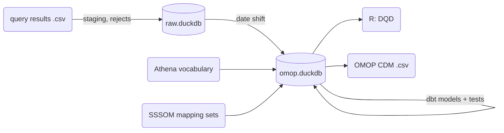
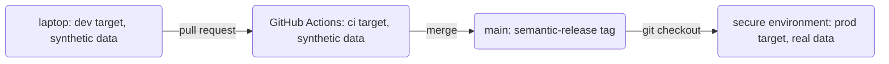

# Plan

This pipeline makes an [OMOP CDM 5.4](https://ohdsi.github.io/CommonDataModel/) from the NUH oncology research data, with [dbt](https://docs.getdbt.com/) and [DuckDB](https://duckdb.org/).
   It is a plan: it says where we are going and in which order. The [issues](https://github.com/Health-Informatics-UoN/nuh-omop-pipeline/issues) track the work.

## Constraints

- The source data is in a SQL Server database that we can only read. We run SQL queries there and export the results as `.csv` files.
- The pipeline runs in a secure environment with Python, R and internet access, but no Docker.
- Patient data never leaves the secure environment. It never goes into this repository or into CI.

## Principles

- **Small slices.** We add one source at a time, from the query results to a finished OMOP table, through every layer, with tests. We learn dbt and the OMOP CDM as we go.
- **SQL in git.** Each step is a dbt model that we can read, test and review in a pull request.
- **Typed data in one database.** The query results are loaded once, with declared types. Each step after that is SQL in DuckDB, not a copy of a file.
- **Fail closed.** If something that can affect privacy looks wrong (an unshifted date, an unknown patient), the build stops.
- **Open from the start.** The models, the tests and the mapping sets are public. Only the data and the secrets are not.

## Design



### Two database files

- `raw.duckdb` holds the query results before the date shift, and the [patient keys](#patient-keys). It can undo the date shift, so it never leaves the secure environment.
- `omop.duckdb` holds only date shifted data, the vocabulary, the mappings and the CDM.
   So the file that we export from can't hold unshifted dates.

### dbt layers

| Layer | What it does |
| --- | --- |
| `staging` | Reads each query result `.csv` with declared types, one model for each query. Rows that break a rule go to a `rejects` model, with the reason. |
| `patient_keys` | One row for each patient: the OMOP `person_id` and the date shift. Each run only adds the new patients. |
| `shifted` | Joins each staging model to `patient_keys`, and adds the shift to the date columns. |
| `int_mappings` | The SSSOM mappings that we accept, after the [mapping policy](#mapping-policy). |
| `int_events` | One long table of events: person, date, source vocabulary, source code, raw value, source table and row. |
| `int_concepts` | Looks up each event: first in `int_mappings`, then in the vocabulary (source code → source concept → `Maps to` → standard concept). Gives the standard concept and its domain. |
| `cdm` | One model for each OMOP table. Each event goes to the table for its domain. Row ids are deterministic, so other tables can point to them. |
| `derived` | `death`, `observation_period`, `drug_era`, `episode`, `episode_event`. |
| `qa` | Tests, the coverage report, and the unmapped terms. |

The [Data Quality Dashboard](https://ohdsi.github.io/DataQualityDashboard/) (DQD) runs in R after `dbt build`.

### The date shift

Each patient's dates move by a random number of days. All dates of one patient move by the same amount, so the time between two events stays the same.
   In SQL, the shift is a join:

```sql
select * replace (e.date_of_event + k.shift_days as date_of_event)
from {{ ref('stg_coded_events') }} e
join {{ ref('patient_keys') }} k using (source_patient_id)
```

The date shift is a privacy control, so the build must fail closed:

- a test that every `DATE` or `TIMESTAMP` column of every staging model is shifted
- a test that the join to `patient_keys` keeps every row (no unknown patients)
- a test that all rows of one patient have the same shift, and that the shift is in the range

Declared types make the first test strong: a date column can't hide as text.
   The shift range is a dbt var. Its real value is set only in the secure environment, and is not in this repository.

### Patient keys

`patient_keys` is the only state that the pipeline keeps between runs:

| Column | What |
| --- | --- |
| `source_patient_id` | the pseudonymised id from the query results |
| `person_id` | the OMOP `person_id`. It stays the same between runs. |
| `shift_days` | the date shift for this patient |
| `first_seen` | the ETL date of the first run that had this patient |

- It is an incremental model (`materialized='incremental'`, `incremental_strategy='append'`, `full_refresh=false`). Each run only adds new patients, and `dbt build --full-refresh` can't make it again.
- A new patient gets a random shift in the range, and the next `person_id`.
- No patient is removed. A patient who is not in one extract keeps their shift when they come back.
   If a patient's shift changed between two releases, a person who compares the releases could find the real date more accurately.
- The first run imports the shifts of the earlier pipeline, so patients keep the shifts that they have in the CDMs that we already released.
- It is backed up after each run, in the secure environment. If it is lost, all patients get new shifts and new `person_id`s.

### How each source maps

| Source | How it maps | Human review? |
| --- | --- | --- |
| ICD10, SNOMED, OPCS4, ICD-O-3 codes | The vocabulary join. Codes with a `.X` placeholder (for example `C50.X`) are fixed before the join. | No - check the coverage report |
| dm+d codes | dm+d → `Maps to` → RxNorm / RxNorm Extension | No |
| Drug names with no dm+d code | An exact match of the normalised name to RxNorm ingredients. The other names get fuzzy candidates for review. **A fuzzy match never goes into the CDM without review.** | Yes, for the names that remain |
| COSD local values (smoking status, laterality, performance status, TNM values), gender, ethnicity | SSSOM mapping sets | Yes, once |
| Episodes, death, observation periods | SQL in `derived` | Pull request review |

Most coded data maps through the vocabulary, with no manual mapping. So every code maps, not only the codes that were common enough to appear in a scan report.

### Mappings: SSSOM

All the mappings that people make are [SSSOM](https://mapping-commons.github.io/sssom/) mapping sets (`.sssom.tsv`).
   We don't use the OMOP `source_to_concept_map` table, because it can't hold enough about each mapping.

SSSOM gives us:

- **the predicate**: `skos:exactMatch`, `skos:broadMatch`, `skos:narrowMatch`, `skos:closeMatch` and others, so we know how good the match is
- **negative mappings**: `predicate_modifier: Not` says "this is not a match", so a rejected candidate is not suggested again
- **the justification**: for example `semapv:ManualMappingCuration` (a person made it) or `semapv:LexicalMatching` (a name match made it)
- **provenance**: the author, the reviewer, the confidence, the date and a comment for each mapping, and an id, a version and a licence for each set
- **sharing**: the [Carrot](https://carrot.ac.uk/) registry of open mappings will use SSSOM, so we can share our mappings and use the mappings of other people

#### Where the mapping sets come from

- **NUH mapping sets** are in this repository, in `mappings/*.sssom.tsv`.
- **Registry mapping sets** come from the Carrot registry, at a pinned version. `mappings/registry.lock` lists the id, version, URL and checksum of each set.
   `fetch_mappings.py` downloads them before `dbt build`, so a build never changes because the registry changed.

#### How dbt reads them

- CI checks each set with [`sssom-py`](https://github.com/mapping-commons/sssom-py) (`sssom validate`).
- `load_mappings.py` loads the sets into two tables: `mappings` (one row for each mapping) and `mapping_sets` (the metadata of each set). dbt reads them as sources.
- dbt keeps the id and the version of each set that it used, next to the CDM, so we can say which mappings made a CDM.

#### Mapping policy

`int_mappings` applies the policy in SQL, so it is visible and has tests:

- Use only `skos:exactMatch` and `skos:broadMatch`. (OMOP often maps to a broader standard concept.)
- Don't use a mapping with `predicate_modifier: Not`.
- Don't use a mapping that no person has reviewed.
- The object must be a standard, valid concept in the loaded vocabulary.
- If two sets map the same subject to different concepts, a test fails. We fix the conflict; dbt does not choose.
- A subject can map to more than one concept in the event tables, but not in `person`.

#### Review

1. Run the build.
2. The `qa` layer writes an SSSOM **candidate set** for the unmapped values: `semapv:LexicalMatching`, a `confidence`, and no `reviewer_id`. Counts below 10 are suppressed, and the labels are checked for patient data before the file leaves the secure environment.
3. Reviewers review the candidates in the Carrot registry (or in a pull request, until the registry is ready).
4. The reviewed mappings come back as a new version of a mapping set.
5. Run the build again.

## Development and deployment

We use dbt Core (the Python CLI), not dbt Cloud. To deploy, we check out a tag in the secure environment and run the build there.

| dbt Cloud | What we use |
| --- | --- |
| Scheduler | Nothing. The extract is manual, so a person starts each run. |
| CI jobs | GitHub Actions |
| Hosted docs | `dbt docs generate` from the fixtures, published to GitHub Pages |
| Environments | Targets in `profiles.yml`: `dev`, `ci`, `prod` |
| Slim CI (`state:modified`, `--defer`) | Not needed. A full build is fast. |



- **Fixtures** are small, hand-written `.csv` files in `fixtures/` with made-up values. They have the edge cases: a blank date, an unknown patient, a `C50.X` code, a date before 1900. dbt unit tests use them: these rows in, these rows out.
- **CI** runs on each pull request: `uv sync --frozen`, `sssom validate`, `dbt parse`, `dbt build --target ci`, `pytest`.
- **Release:** a merge to `main` makes a tag with semantic-release. The build writes the tag into `cdm_source.cdm_etl_reference`, so each CDM shows the code that made it.
- **Targets** are different only in their paths and limits. The input folder is a dbt var (`input_dir`): `ci` reads `fixtures/`, and `prod` reads the query results.

### Privacy rules

- `.gitignore` is an allowlist. It allows `.csv` only in `fixtures/`, and `.sssom.tsv` only in `mappings/`.
- Docs are made only from the fixtures, never from the `prod` database.
- `--store-failures` writes the failing rows into the database. They stay in the secure environment and are never exported.
- `target/` and `logs/` are not committed.
- dbt's usage data is turned off (`send_anonymous_usage_stats: false`).

## Slices

| Slice | Issue | Source → OMOP | New dbt ideas | New OMOP ideas |
| --- | --- | --- | --- | --- |
| 0 | #1 | set up, no data | project, profiles, targets, `dbt build`, CI | - |
| 1 | #2 | `demographics` → `person` | sources, staging, `ref`, seeds, generic tests, unit tests, vars | `person`, `concept_id` / `source_value` / `source_concept_id`, concept 0 |
| 2 | #3 | `death` → `death` | `relationships` tests, the `rejects` model | `death`, type concepts |
| 3 | #4 | date shift, stable `person_id` | incremental models, macros, custom tests | - |
| 4 | #5 | coded events → `condition_occurrence` and the other clinical tables | large sources, intermediate models, materializations | the vocabulary tables, standard and source concepts, `Maps to`, domains |
| 5 | #6 | all events → `observation_period` | models that read many models | `observation_period` |
| 6 | #7 | SACT drugs → `drug_exposure`, `drug_era` | string normalisation | dm+d, RxNorm, ingredients, `concept_ancestor` |
| 7 | #8 | local codes → SSSOM mapping sets | Python helpers, policy tests | `measurement` values and units, the remaining domains |
| - | #9 | DQD and the export | - | the DQD checks |

After these, the oncology tables: `episode` and `episode_event` (disease episodes from the diagnoses, treatment episodes from SACT regimens and surgery), and TNM stage in `measurement` with Cancer Modifier concepts.

Until this pipeline makes the full CDM, the earlier pipeline keeps running. Each slice compares its tables with the tables of the earlier pipeline, and we write down each difference and why it is correct.

## Risks

| Risk | What we do |
| --- | --- |
| The output is different from the earlier pipeline in a way that we don't see | Compare in each slice, and explain each difference |
| The date shift leaks an unshifted date | The fail closed tests, and the two database files |
| `patient_keys` is lost or made again | `full_refresh=false`, a backup after each run, and tests |
| The vocabulary files are large | Download only the vocabularies that each slice needs |
| A registry mapping set changes | `mappings/registry.lock` pins each set by version and checksum |
| A fuzzy drug name match is wrong | The mapping policy uses no mapping that a person hasn't reviewed |
| R and Python use different `duckdb` versions | Pin both |

## Open questions

1. Who reviews the mappings in the Carrot registry: our team, clinicians, or other trusts?
2. Which CURIE prefixes do the local codes use (for example the COSD data items)? We agree them with the Carrot registry, so other people can use our mapping sets.
3. The `person_id`s of this pipeline are not the same as those of the earlier pipeline. Is it a problem for the users of the CDM that all `person_id`s change one time, at the change of pipeline?
